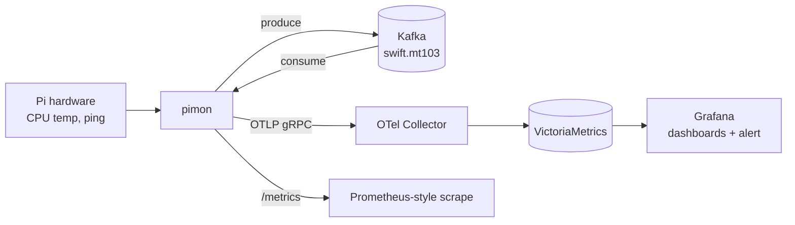

# swift-mt103-monitor (`pimon`)

[](https://github.com/malhar-sk/swift-mt103-monitor/actions/workflows/ci.yml)
[](LICENSE)

A small Go telemetry agent for a Raspberry Pi 5. It simulates a SWIFT MT103 payment message bus over Kafka, tracks
queue depth, duplicates and SLA breaches, and ships those metrics plus Pi hardware metrics via OpenTelemetry to a
VictoriaMetrics + Grafana stack. On the author's setup everything runs over a private Tailscale network.

> **Simulation only.** The MT103 messages are random and minimal (blocks 1, 2 and a field-32A-style block 4), not
> real payments. The bank codes are five well-known BICs used as placeholders.

## What it does

- Scrapes Pi hardware metrics (CPU temperature, ping latency to 1.1.1.1)
- Produces simulated MT103 messages to the `swift.mt103` Kafka topic, two per second, dropping a configurable share
  before they are sent (default 15%)
- Consumes the topic and tracks each message until it is acknowledged; anything unacknowledged for more than 5 s is
  an SLA breach
- Exports all metrics via OTLP gRPC to a collector, and also on a Prometheus `/metrics` endpoint
- Runs as a systemd service on the Pi

## How the simulation behaves (read before trusting the graphs)

- **ACKs are simulated by a timer**: the monitor acknowledges each queued message after about 1–2 s. An SLA breach
  therefore only happens when the monitor falls behind (for example, the Pi is overloaded), not on every run.
- **Producer-side drops never reach Kafka**, so the monitor cannot see them; they are only printed as `[DROPPED]`.
  `swift.messages.dropped` counts the monitor's SLA timeouts.
- **Duplicates** come from transaction IDs being random 6-digit numbers (`TXN0`–`TXN999998`), so collisions do
  happen over a long run. That is what the duplicate detector catches.

## Metrics

| Metric | Type | Description |
|---|---|---|
| `pi.cpu.temperature` | Gauge | CPU temperature in °C (Prometheus: `pi_cpu_temperature_celsius`) |
| `pi.ping.latency` | Gauge | Ping latency to 1.1.1.1 in ms (Prometheus: `pi_ping_latency_ms`) |
| `swift.messages.sent` | Counter | MT103 messages seen by the monitor |
| `swift.messages.dropped` | Counter | Messages removed after an SLA timeout |
| `swift.messages.duplicates` | Counter | Messages whose transaction ID was already seen |
| `swift.queue.depth` | Gauge | Messages currently unacknowledged |
| `swift.sla.breaches` | Counter | Messages unacknowledged for more than 5 s |

## Architecture



## Build and run

Needs Go (see `go.mod`), and a reachable Kafka broker and OTel collector.

```bash
go test ./...                                   # unit tests, no Kafka needed
GOOS=linux GOARCH=arm64 go build -o pimon .     # build for the Raspberry Pi 5

PIMON_KAFKA_BROKER=127.0.0.1:9092 \
PIMON_OTLP_ENDPOINT=127.0.0.1:4317 \
PIMON_METRICS_ADDR=127.0.0.1:9100 \
PIMON_FAIL_RATE=0.15 \
./pimon
```

| Variable | Default | Meaning |
|---|---|---|
| `PIMON_KAFKA_BROKER` | `127.0.0.1:9092` | Kafka broker for the `swift.mt103` topic |
| `PIMON_OTLP_ENDPOINT` | `127.0.0.1:4317` | OTel collector (OTLP gRPC, no TLS: keep it on a private network) |
| `PIMON_METRICS_ADDR` | `127.0.0.1:9100` | Where `/metrics` listens |
| `PIMON_FAIL_RATE` | `0.15` | Share of messages the producer drops before sending (0–1) |

On the Pi it runs as a systemd service (`sudo systemctl start pimon`) with these variables set to the Tailscale
addresses of the collector and broker.

## Alert

A Grafana alert fires when `swift.sla.breaches > 0` and is routed to the `pimon-alerts` contact point.

## Related projects

- [mt103-extractor-lora](https://github.com/malhar-sk/mt103-extractor-lora): a fine-tuned small model that turns
  messy payment text into MT103 JSON; its synthetic data borrows this simulator's BICs and reference pattern.
- [fleet-voice-agent](https://github.com/malhar-sk/fleet-voice-agent): ask a device fleet questions by voice,
  including a simulated payment-SLA feed of the same kind.

## License

MIT, see [LICENSE](LICENSE).
